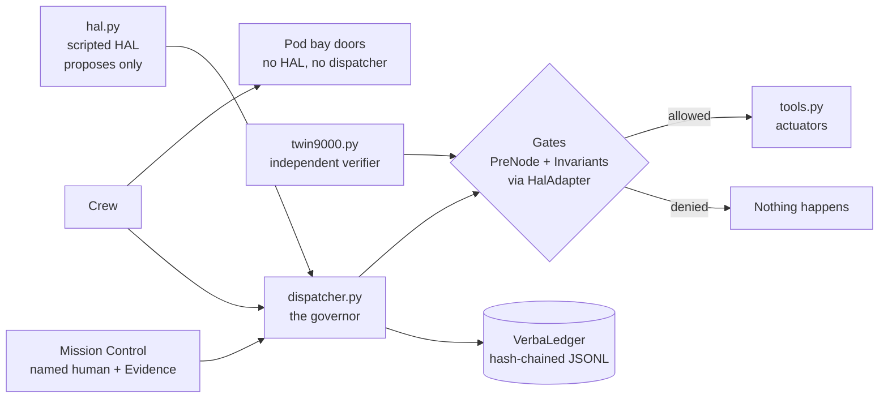

# Architecture

HAL proposes. The dispatcher decides. Only the dispatcher can reach the actuators, and it records every decision.

## The path of one proposal

1. `hal.py` returns a `Proposal`. It imports only `domain.py`, so it has no way to act.
2. `dispatcher.py` refuses at once if HAL is halted, and logs the refusal.
3. It looks up the proposal's route. An action with no route is refused, so anything nobody listed stays closed.
4. Each compiled gate runs before anything happens. A PreNode denial records it and stops there. An Invariant violation also enters `hal_suspended`.
5. If every gate passes, the dispatcher records that and calls the actuator.

## What VSL-Core does and what this repo does

| VSL-Core provides | This repo provides |
|---|---|
| `PreNode`, `Invariant`, `TerminalState`, `AssuranceBasis` | The rules, in `governance.py` |
| The `VSLAdapter` contract and conformance suite | `HalAdapter`, which raises with the real identity |
| `VerbaLedger`, `audit()`, `issue_certificate()` | Every ledger write, in `ledger_writer.py`, because the ledger doesn't write itself |
| `request_re_enablement()` | The halted flag, because VSL-Core has no running state, and the named-approver check |

`Fallback` stays declarative: a gate checks once and doesn't retry, as in VSL-Core's reference adapter.

## The boundary is only as strong as what enforces it

The gate must run outside the thing it governs. Here that boundary is a Python import rule, and `tests/test_boundaries.py` proves `hal.py` can't reach `tools.py`. **Python can't enforce this on its own.** Any code in the same process could import `tools` and bypass everything. In a real deployment this boundary is a process or hardware boundary: the agent holds no credentials for the actuators, and only the governor does.

The doors work differently. Refusing to open them is HAL doing nothing, and gates only stop actions, so no gate could help. Crew door commands go straight to the actuator. `hal.py` has no door method, and doors aren't a dispatcher action.

## The web demo

`hal9000-demo` is a thin standard-library server over `scenes.py`, so the page calls the same dispatcher, gates and ledger as the scripts. It binds to `127.0.0.1` and accepts only local `Host` headers and JSON posts, so other machines and websites can't drive it. The ledger sits in a temporary folder for the life of the server.
